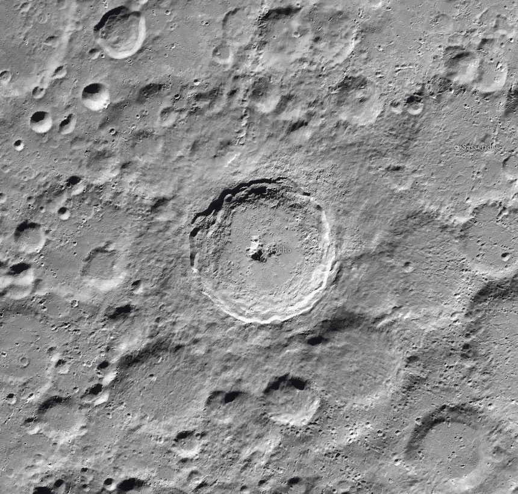
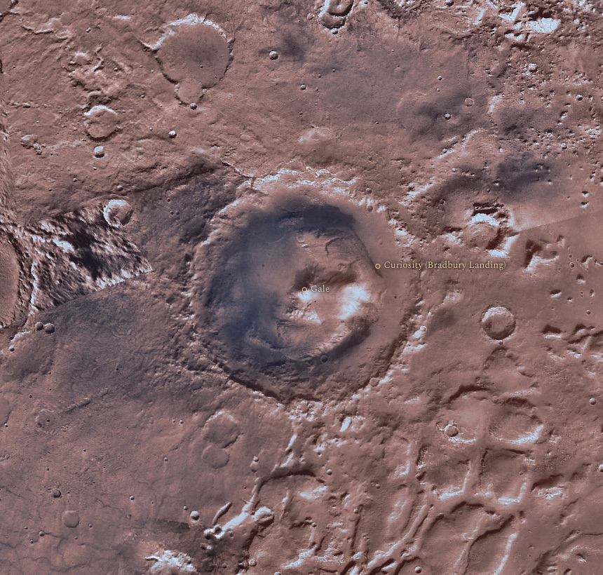
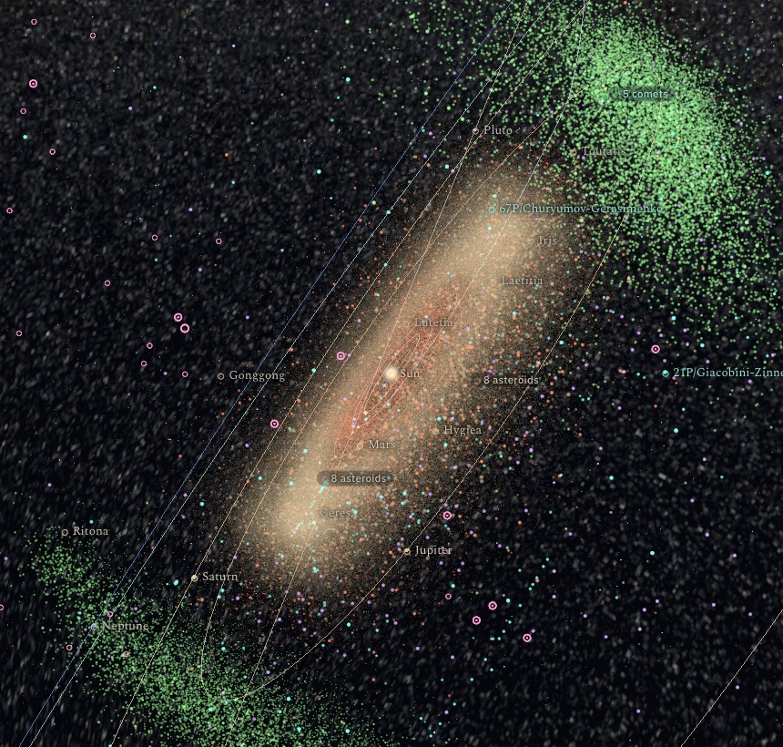
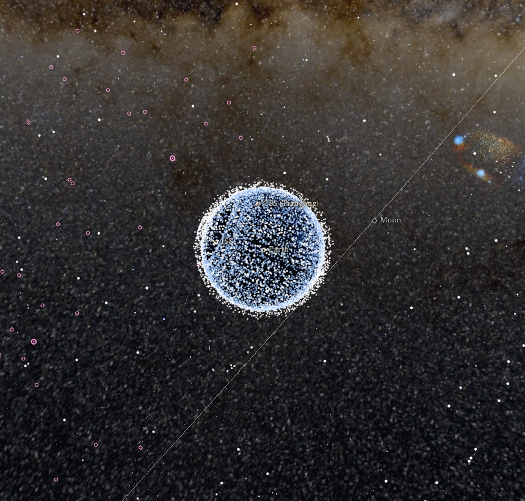
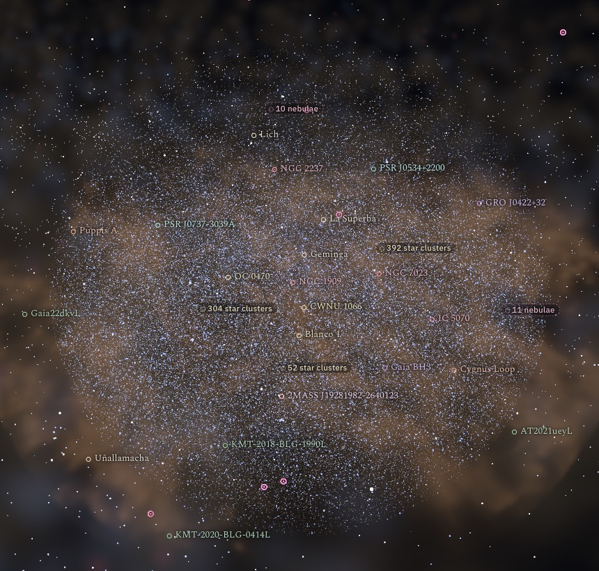
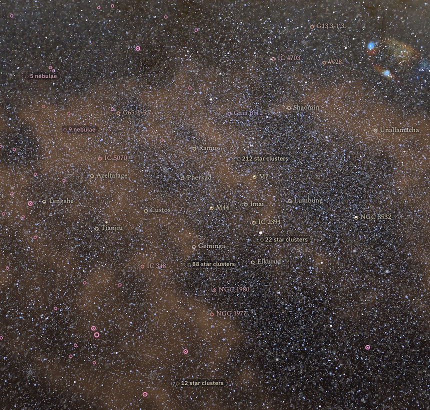
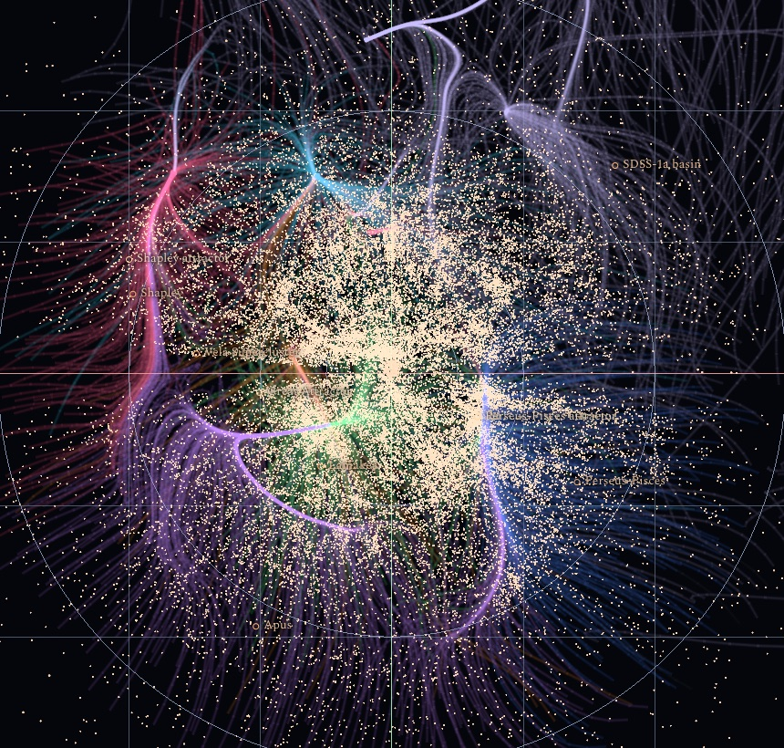
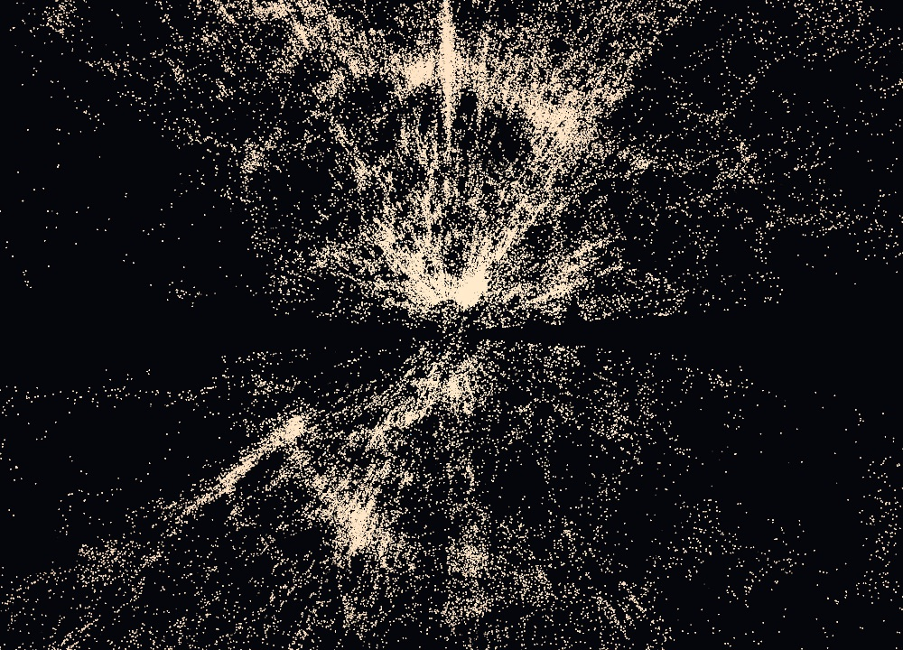
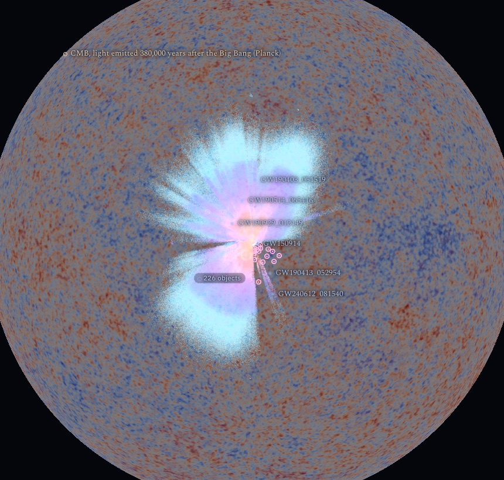

# Cosmic Atlas

**A 3D map of the real universe in your browser, from Earth to the cosmic web, built only from open survey data.**

**[Open the atlas →](https://cosmic.bristleconelab.org/)**
(mirror: [ismoilovdevml.github.io/cosmic-atlas](https://ismoilovdevml.github.io/cosmic-atlas/))

[](https://doi.org/10.5281/zenodo.24224239)


Fly from your own planet past Saturn, out of the Milky Way, past Andromeda and into the web of
15 million galaxies mapped by DESI. Every point is a real object at its measured position. Every
number on screen comes with the catalogue it came from.

## What you can do

- **Fly across 19 orders of magnitude** in one continuous scene, from planet surfaces (10⁷ m) to
  billions of light-years (10²⁶ m). Scroll to zoom and drag to turn.
- **Take a guided tour** with narration in Uzbek, English or Russian: black holes (circle one,
  watch the clocks drift apart, fall towards the horizon), the Milky Way, the life of a star, the
  universe out to the CMB, and the Solar System, plus the scale tour.
- **Search for anything**: a planet, a star, a galaxy, a black hole or an exoplanet, or type sky
  coordinates (`83.82 -5.39`, `05h35m17s -05d23m28s`, `l=209 b=-19`). The camera flies there.
- **Click any object** for its distance, size and other facts, with the source and links to
  SIMBAD, Gaia and the DESI viewer.
- **See the uncertainty.** Distances are measurements, and the atlas shows each object's 16–84 %
  range.
- **Watch the Solar System move** in real time, or run time forward ×10⁴ or ×10⁶: 1.58 million
  asteroids, comets and 16,896 satellites follow their real orbits.
- **Land on the Moon and Mars.** NASA surface imagery streams in as you descend, with named
  craters, valleys and 21 landing sites.
- **Move the stars in time**, up to 100 million years either way, along their Galactic orbits
  (Gaia velocities in the MWPotential2014 model, checked against galpy).
- **Show me**: fly from the cosmic web down to the place where you are. Your location stays in
  the browser and is never sent or stored.
- **Fly into a black hole.** One button takes you to 25 Schwarzschild radii of Sgr A*, M87* or
  Gaia BH3. The light around it is ray-traced in general relativity, and a live readout shows how
  time slows and tides grow as you go closer.
- **Read about anything.** Every object links to a short article, in Uzbek, English or Russian.
  The 57 articles, with their sources, are also plain web pages:
  [English](https://cosmic.bristleconelab.org/learn/en/),
  [Oʻzbekcha](https://cosmic.bristleconelab.org/learn/uz/),
  [Русский](https://cosmic.bristleconelab.org/learn/ru/).
- **Share a view.** The link names the object you are looking at, e.g. `#at=Saturn`. Save views
  and play them back as a short story.
- **Jump across scales** with one click from the bar under the search: Earth, Saturn, Sgr A*,
  Gaia BH3, the Orion Nebula, Andromeda, Laniakea, the cosmic web and the CMB. Layer presets
  (Solar System, Milky Way, Laniakea, messengers) switch a whole set of layers at once.
- **Constellations in 3D.** 20 constellations drawn between the real positions of their named
  stars: from Earth they look familiar, from a few hundred parsecs away they fall apart. "Night sky
  from here" looks straight up from your location at the current time.
- **Measure** the 3D distance between any two objects, in parsecs, light-years and Voyager 1
  travel time. Cards show small diagrams: a star on the HR diagram, a black hole's horizon next to
  the Sun and the planets' orbits, an exoplanet system next to Mercury, Earth and Jupiter.
- **Save a photo** of the view with a caption, or press `H` to hide every panel. Tours can be read
  aloud by the browser's speech voice.

## What's in it

| | Objects | Source |
|---|---|---|
| Solar System | Sun, 8 planets, Pluto, the Moon, major moons, 5 interstellar probes | astronomy-engine (VSOP87, checked against JPL Horizons), JPL Horizons |
| Asteroids and comets | 1,580,450 asteroids and 4,666 comets on their orbits | IAU Minor Planet Center |
| Earth satellites | 16,896, plus JWST | CelesTrak (SGP4), JPL Horizons |
| Moon and Mars surfaces | 861 named features, 21 landing sites, streamed surface imagery | NASA Moon/Mars Trek (LRO, Viking, MRO CTX), IAU Gazetteer |
| Stars | 39,629,790 Gaia DR3 stars within 1 kpc with space velocities, 309 bright stars from Hipparcos, 653 named stars | ESA Gaia, Bailer-Jones et al. 2021, Hipparcos (van Leeuwen 2007), IAU |
| Star clusters | 7,181 star clusters | Hunt & Reffert 2023/24, Baumgardt |
| Exoplanets | 6,442 planets in 4,834 systems | NASA Exoplanet Archive |
| Pulsars | 4,429 | ATNF Pulsar Catalogue |
| Black holes | 40, from Sgr A* and M87* to Gaia BH3 | GRAVITY, EHT, Gaia, BlackCAT |
| Nebulae and supernova remnants | 421 + 312 | OpenNGC, Green 2024 |
| Nearby galaxies | Local Group, Local Volume, 1,016 with real shapes and images | McConnachie, UNGC, HyperLEDA, DSS2 |
| Distant galaxies | 15,140,002 galaxies and quasars | DESI DR1 |
| All-sky galaxies | 43,463 + 55,877 | 2MRS, Cosmicflows-4 |
| More redshift surveys | 2,313,525 + 86,804 + 146,845, only objects DESI does not have | SDSS DR17, 6dFGS, 2dFGRS |
| Cosmic flows | Laniakea and 8 more basins, 2,587 streamlines, 6,201 galaxy groups | Cosmicflows-4++ (Courtois et al. 2025), Dupuy & Courtois 2023, Tully 2015 |
| Messages to the stars | Arecibo 1974 and 30 more, plus the Wow! signal | cited per entry |
| Interstellar dust | 3D dust clouds within 1.25 kpc (6 pc grid), dark in front of the stars, a glow from outside | Edenhofer et al. 2024 |
| Gravitational waves | 282 merger events with their 90 % localisation volumes | LIGO/Virgo/KAGRA GWTC via GWOSC |
| Fast radio bursts | 3,661 bursts on the sky, 101 with a host galaxy | CHIME/FRB Catalog 2, FRB host repository |
| Neutrinos | 349 IceCube alerts with error regions, 2 identified sources, KM3-230213A | IceCat-1, KM3NeT |
| Sky backgrounds | Gaia (visible), eROSITA (X-ray), Planck 857 GHz (dust) | ESA, MPE, Planck |
| Cosmic microwave background | The Planck map as the edge of the observable universe, 13.8 billion years old light | Planck PR3 |

## Screenshots

| | |
|---|---|
|  |  |
| **Earth**, with day and night at the current time | **Jupiter** and its moons on their real orbits |
|  |  |
| **M81**, with size and tilt from HyperLEDA | **The cosmic web**: DESI galaxies in a 50 Mpc slice |
|  |  |
| **Sgr A\***: the far side of the disk is bent over the shadow | **Gaia BH3** bends the real Milky Way around it |
|  |  |
| **Tycho** on the Moon, NASA LRO imagery | **Gale crater** on Mars, where Curiosity landed |
|  |  |
| **The asteroid belt** and Jupiter's two Trojan swarms | **Earth** inside its shell of satellites |
|  |  |
| **3D dust** around the Sun, seen from 2.6 kpc | **Star clusters** in the Milky Way's disk |
|  |  |
| **Laniakea**: where nearby galaxies flow, by basin | **Five redshift surveys** in one 50 Mpc slab |


*Accuracy check: Andromeda in the atlas (left) next to an independent reprojection of the
Digitized Sky Survey image (right). Size, angle and satellite galaxies match.*


*DESI DR1 out to a billion parsecs. The dark wedges are parts of the sky the survey has not
observed.*


*The edge of the map: the Planck cosmic microwave background, drawn as a shell around every galaxy
survey.*

## Limitations

The atlas places real measurements, but a 3D map of the universe has to make choices. These are the
ones that change what you see:

- **Galaxies sit where their redshift puts them.** DESI, SDSS, 6dFGS, 2dFGRS and 2MRS galaxies are
  placed at the Planck 2018 comoving distance of their heliocentric redshift. Their own motions
  (a few hundred km/s, up to about 1,000 km/s inside clusters) are not removed, so galaxy clusters
  look stretched along the line of sight into "fingers" that point at the Sun. The redshifts are also
  not moved to the rest frame of the cosmic microwave background: the Sun moves at 370 km/s relative
  to it, which pushes redshift distances out by up to about 5.5 Mpc on one side of the sky and pulls
  them in on the other. Below z = 0.003 (about 13 Mpc) redshift distances are not used at all; those
  galaxies are placed at measured distances (Cepheids, TRGB, Tully-Fisher, …) or left out.
- **Two distance scales meet between about 10 and 50 Mpc.** Redshift distances use H0 = 67.66 km/s/Mpc
  (Planck 2018). Measured, redshift-independent distances (UNGC, Cosmicflows-4) follow the local
  distance ladder, which corresponds to H0 of about 73 to 75. The same galaxy can therefore sit up to
  about 10 % farther away in a redshift layer than in a measured-distance layer. 86 of the 868 Local
  Volume galaxies only have the catalogue's Hubble-flow estimate (H0 = 73). The Cosmicflows-4 flows
  and groups are drawn on the Planck scale (h = 0.6766), and their info cards also give the
  Cosmicflows (H0 = 75) distance.
- **One scene, many epochs.** Every distant object is placed at its comoving distance, where it is
  now, but what it stands for is the light that left it long ago. A quasar at z = 2 is shown as it was
  10.5 billion years ago; the cosmic microwave background, 13.9 Gpc away, as it was 372,000 years after
  the Big Bang; the nearest stars as they were a few years ago. The map is not a picture of a single
  moment.
- **Black hole spin is illustrative.** The fly-in view ray-traces the Schwarzschild metric. Real black
  holes spin (Kerr), which shifts and flattens one side of the shadow. The spin slider moves the
  horizon, the disk's inner edge and its orbital speed to their Kerr values, but light still follows
  Schwarzschild paths with an approximate frame-dragging tilt; it is not a Kerr ray trace. Far from Earth, the sky behind
  a hole is the sky as seen from Earth, because the real sky at that spot is not known at this
  resolution.

## Run it locally

```bash
git clone https://github.com/ismoilovdevml/cosmic-atlas && cd cosmic-atlas/web
npm ci
npm run dev        # http://localhost:5173
```

The repository holds the code and the small catalogues. The large point layers (Gaia, DESI) are
built from the original archives with the scripts in `scripts/` and `pipeline/`; see
[docs/data-contract.md](docs/data-contract.md). The web tile set is archived on Zenodo:
[10.5281/zenodo.24226088](https://doi.org/10.5281/zenodo.24226088). To publish your own copy, see
[docs/deploy.md](docs/deploy.md).

## How it works

- **Rendering**: WebGPU through three.js, with a WebGL2 fallback. Camera maths runs in float64,
  so one scene holds a planet and a galaxy cluster without jitter.
- **Streaming**: every large layer is an octree of small binary tiles. The browser loads only
  what is on screen, up to a point budget, and draws regions that aren't loaded yet as their
  total light. The shallow levels are served with the site; the deep levels of Gaia, DESI and SDSS
  stream from a [Hugging Face dataset](https://huggingface.co/datasets/ismoilovdev/cosmic-atlas-tiles).
- **Science first**: Planck18 cosmology, Bailer-Jones distances for Gaia stars, IAU radii, and a
  cited source for every number. Each catalogue has a re-runnable script and a `PROVENANCE.json`
  with its query, date and citation.

More detail: [web/README.md](web/README.md) (the viewer), [docs/prior-work.md](docs/prior-work.md)
(other projects and how this one differs), [docs/content-contract.md](docs/content-contract.md)
(object types and in-app articles).

## Credits

- **Data:** ESA/Gaia/DPAC, the DESI Collaboration, NASA Exoplanet Archive, ATNF, JPL, 2MRS,
  Cosmicflows-4, SDSS, 6dFGS, 2dFGRS, HyperLEDA, the IAU Minor Planet Center, CelesTrak, NASA Trek, LIGO/Virgo/KAGRA,
  CHIME/FRB, IceCube, KM3NeT, eROSITA-DE, Planck, CDS (SIMBAD, VizieR, HiPS), OpenNGC (CC BY-SA 4.0; our derived NGC
  catalogues carry the same licence), and every paper cited in the
  catalogues.
- **Images:** NASA Blue Marble and Black Marble 2016 night lights (public domain), Solar System
  Scope textures (CC BY 4.0), DSS2
  colour via CDS and IRSA.
- **Rendering ideas:** learned from [skymap](https://github.com/rulkens/skymap) (MIT,
  © 2026 Alexander Rulkens) and re-implemented.

## License

The code is [MIT](LICENSE). The data keeps its own licences. Gaia is **CC BY-NC 3.0 IGO**, so
this project is non-commercial. DESI DR1 is CC BY 4.0. The others are listed in each layer's
`PROVENANCE.json`.
